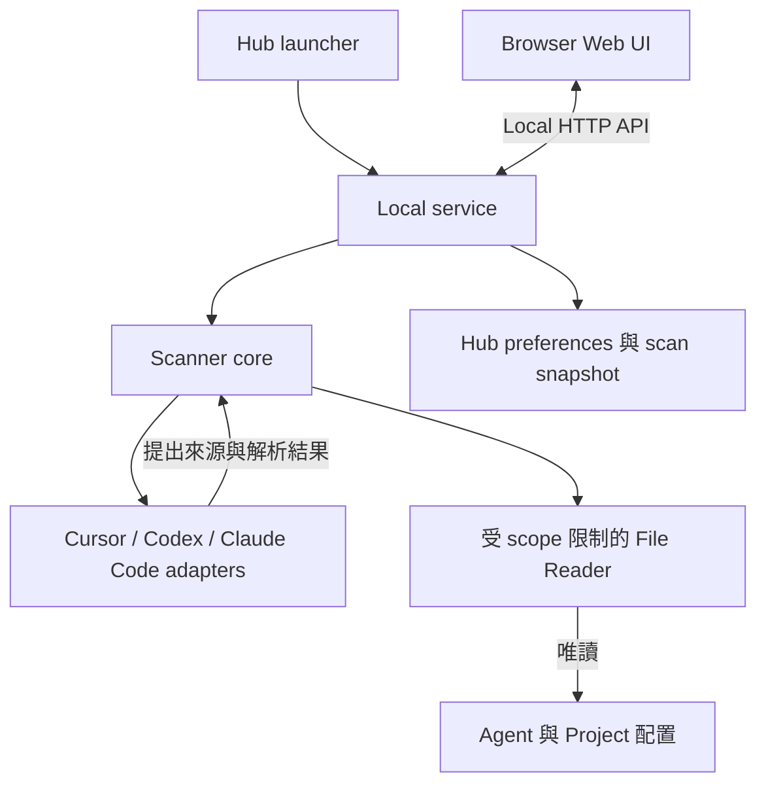
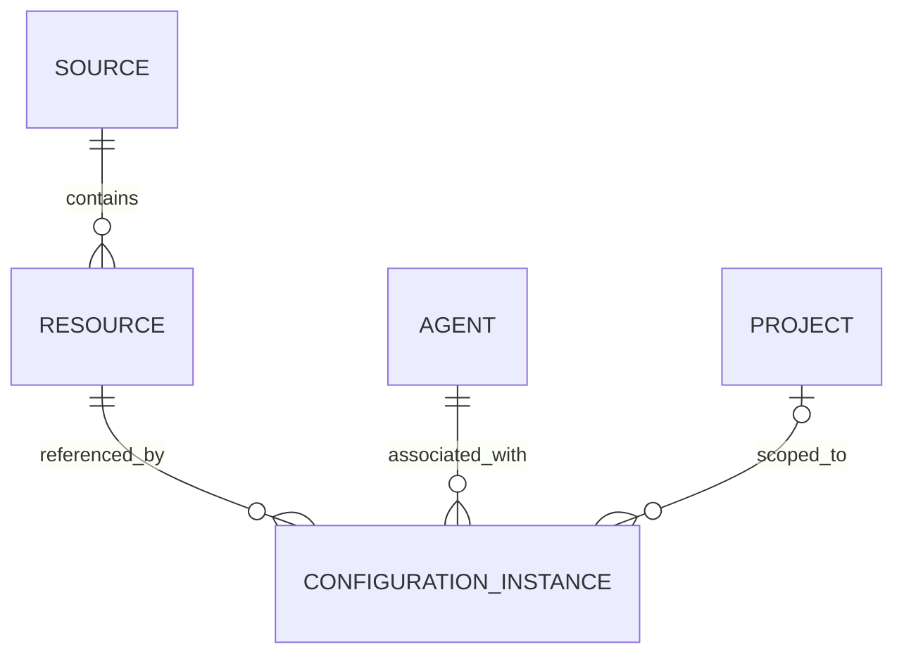

# AI Engineering Hub — Technical Architecture v1

狀態：v1 已定稿（2026-11-12）；第 1–4 章皆已確認，第一個 Codex project Skills 里程碑已實作。驗證結果與限制見 milestone-1-verification.md。
更新日期：2026-11-12

依據：[Product Specification v1](product-specification-v1.md)、[配置支援表](configuration-support-v1.md)。產品範圍以已定稿文件為準；本文件逐項決定如何實現，不新增產品功能。說明使用繁體中文，技術術語保留慣用英文。

| 順序 | 內容 | 狀態 |
| --- | --- | --- |
| 1 | 系統結構、技術選型與啟動方式 | 已確認 |
| 2 | Resource、Configuration Instance 與來源關聯的資料模型 | 已確認 |
| 3 | Scanner、scope、symlink、錯誤處理與資料保存 | 已確認 |
| 4 | 最小端到端驗證與後續實作順序 | 已確認，第一個里程碑已實作 |

## 1. 系統結構與技術選型

### 1.1 系統結構（已確認）

採一個本機 Node.js process，內部按職責拆成 modules。Web UI 在瀏覽器執行，由本機服務提供 API 與建置完成的靜態檔案。Scanner 是服務內部可獨立測試的 module，第一版不拆成另一個服務。

| 部分 | 責任 | 邊界 |
| --- | --- | --- |
| Web UI | Onboarding、Dashboard、搜尋篩選、Resource Detail、掃描狀態 | 透過 API 取得整理後資料，不自行讀取本機檔案 |
| Local service | 啟動、API、request validation、scan lifecycle、提供前端檔案 | 只在本機 loopback 提供服務；不能把任意網頁請求視為已授權 |
| Scanner core | 協調探索、統一結果與錯誤、限制讀取範圍 | 不依賴 React 或 HTTP framework，不推導 agent 最終生效狀態 |
| Agent adapters | 描述各 agent 的來源位置、格式與原始 scope，解析讀取內容 | 透過共用 File Reader 取得內容，不各自繞過 scope 或 symlink 檢查 |
| Hub storage | 保存探索範圍與最近 scan snapshot | 只寫 Hub 自己的資料；採第 3 章確認的 versioned JSON 與 cache policy |

以上拆分是 code modules 的邊界，不代表要建立多個部署服務或公開 plugin framework。

### 1.2 技術組合（已確認）

| 部分 | 選擇 | 選擇理由與代價 |
| --- | --- | --- |
| 語言 | TypeScript | UI、API 與 scanner 使用同一語言，方便共用資料契約；API 與檔案輸入仍需 runtime validation |
| Web UI | React + Vite | 適合本機互動式 Dashboard，建置成靜態檔案隨 Hub 發布；routing 與資料讀取方式需自行選擇 |
| Local service | Node.js LTS + Fastify | 負責本機檔案處理與 HTTP API；Fastify 提供 TypeScript 支援及 request validation 能力，具體 schema 在 API 設計時決定 |
| Scanner | TypeScript modules + Node.js filesystem APIs | 共用 read-only File Reader，三個 adapters 各自處理格式；保留未來替換 UI 或 host 的空間 |
| 安裝與啟動 | npm package + CLI launcher | 安裝時包含建置完成的 UI 與 server，之後可離線啟動；使用者需先有相容的 Node.js runtime |

本輪不固定套件版本。建立專案時選定相容的 Node.js LTS 與套件版本，記錄於 package metadata 與 lockfile；不使用每次啟動都下載 latest 的方式作為離線流程。

### 1.3 取捨

- **Fastify 與 Hono**：Hono 可透過 Node.js adapter 提供本機 API，也是可行選擇。Hub 目前沒有跨 runtime 部署需求；Fastify 的 schema validation 與 serialization 能直接對應本機 API 邊界，因此保留 Fastify。這不是效能測試結論，兩者都足以作為候選。
- **Node.js 與 Bun**：Bun 整合 runtime 與多種開發工具，但 Hub 目前最重要的是讀取正確性、scope 與 parser 行為，尚無證據顯示 runtime 效能是瓶頸。保留 Node.js LTS；不為尚未量測的效能收益變更 runtime。
- **React + Vite 與 Next.js**：兩者都能實現本產品；目前主要需求是瀏覽器互動與本機檔案探索，沒有 SSR 或 SEO 需求，因此建議先採 Vite，把本機服務生命週期與 UI build 分開。這是本專案的取捨，不是 Next.js 不能在本機執行。
- **Node.js 與 Python backend**：目前核心是檔案讀取與配置解析，尚無需要 Python 專用函式庫的工作；統一 TypeScript 可減少兩套 runtime 與 API types 的維護。若未來出現具體需求再評估。
- **本機 Web UI 與桌面包裝**：本輪沿用已確認的 Web UI 交付方式。日後若包成桌面 App，scanner 與資料契約可望沿用，但 launcher、transport 與權限整合仍需調整。
- **資料庫**：依第 3 章已確認的策略，第一版採 versioned JSON 保存設定與最近結果；SQLite 留待實測需求，不引入 ORM 或 database server。

### 1.4 啟動與停止體驗

1. 使用者完成一次安裝；具體 package 名稱與 CLI 名稱尚未決定。
2. 執行 Hub 的啟動指令，建立 local service，載入 Hub preferences 與最近 snapshot。
3. 自動開啟瀏覽器；若無法自動開啟，顯示可手動開啟的本機網址。
4. 首次進入 onboarding；後續顯示最近結果及掃描時間，使用者手動開始掃描。
5. 終端機中的 process 維持運作。關閉 browser tab 不等於停止服務；使用者結束啟動指令時停止服務。MVP 不預設安裝 background daemon。

開發時可使用 Vite dev server；交付版本由 local service 提供 build 後的 UI，不要求使用者跑前端開發環境。UI assets 隨套件提供，核心流程不依賴外部 CDN。

Local service 的 API 需驗證 session 與 request origin，限制 Host，並由服務端執行 scope 與路徑檢查；僅綁定 loopback 不能取代這些措施。不將完整本機檔案系統直接暴露成通用讀取 API。具體機制在第 3 章展開。

### 1.5 決策紀錄

2026-11-11：使用者授權在沒有明顯更適合選項時採用原組合。比較 Hono、Bun、Next.js 與 Python backend 後，依目前需求未發現足以抵銷變更代價的優勢，因此確定採用 TypeScript、React + Vite、Node.js LTS + Fastify，以及 npm package + CLI launcher。接著進入資料模型設計。

此決策以目前 MVP 為準，不主張這套組合對所有情境最佳。Node.js 安裝依賴仍是交付代價；若後續要求免裝 runtime 或雙擊啟動，再獨立評估 distribution 方式。儲存方式已於第 3 章確定採 JSON；UI component library 與具體套件版本尚未選定。

### 1.6 官方參考

查核日期：2026-11-11。以下支持工具能力；選型理由是依本專案需求做出的判斷。

- [Vite Guide](https://vite.dev/guide/)：dev server 與靜態 build。
- [React：Creating a React App](https://react.dev/learn/creating-a-react-app)：framework 與自行組合工具的選項。
- [Fastify TypeScript](https://fastify.dev/docs/latest/Reference/TypeScript/)：TypeScript 整合。
- [Fastify Validation and Serialization](https://fastify.dev/docs/latest/Reference/Validation-and-Serialization/)：API schema 與 runtime validation，實作前需確認具體設定。
- [Node.js Releases](https://nodejs.org/en/about/previous-releases)：production 使用受支援 LTS 的原則。
- [Hono on Node.js](https://hono.dev/docs/getting-started/nodejs)：以 Node.js adapter 執行的替代方案。
- [Bun Runtime](https://bun.sh/docs/runtime)：整合 runtime 與開發工具的替代方案。

## 2. 資料模型

狀態：已確認（2026-11-11）。這是 Hub 的資料設計，不代表各 agent 內部採用相同模型；資料保存方式於第 3 章討論。

### 2.1 三個核心概念

| 概念 | 回答的問題 | 建議保留的資訊 |
| --- | --- | --- |
| Source | 內容實際從哪裡讀取？ | sourceId、已驗證的 canonical path、來源格式、讀取時間與狀態 |
| Resource | 這個來源中的哪個資源？ | resourceId、type、名稱、sourceId、entry locator、可安全展示的內容與 metadata |
| Configuration Instance | 哪個 agent 在哪個配置情境中引用它？ | instanceId、resourceId、agentId、原始 discovery path、scope、projectId、base directory、發現依據 |

Source 是檔案層級，Resource 是檔案內可獨立呈現的條目，Configuration Instance 是 agent 與條目的配置關聯。Instance 不表示已安裝、載入或執行。

例如一份 MCP 設定檔可包含多個 server entries，因此是 1 個 Source、多個 Resources。Skill 第一版以 `SKILL.md` 為入口；不把資料夾內每個 script 都當成獨立 Resource，也不承諾讀取整個 Skill package。

### 2.2 Resource identity 與計數

MVP 採保守的 identity 規則：以「已確認的來源 identity + resource type + entry locator」識別 Resource，不以名稱、內容相似度或 MCP URL 合併。

- 指令檔的 entry locator 是整份文件；MCP 的 locator 是結構化 key path，例如 `mcpServers → github`，而非只保留 `github` 這個名稱。
- 同一來源、同一條目被多個 agents 發現，可共用 Resource；不同 discovery path、agent、scope 或 project 的關聯以 Configuration Instances 保留。
- 相同名稱或相同內容位於不同檔案時，保留為不同 Resources。MVP 不推定兩者來自同一個上游 Skill 或同一服務。
- 同一路徑內容更新，保留 Resource identity，更新 snapshot 內容；移動檔案或改名可能產生新 identity，第一版不做跨路徑歷史追蹤。
- 同一條目由不同 adapter 解讀時，只有 entry locator 與 type 明確一致才共用 Resource；agent 專屬 metadata 放在 Instance，避免互相覆寫。

Dashboard 分開顯示 Resource 數量與配置關聯數量，不把 Instance 數稱為「安裝份數」。Agent / Project 篩選先作用於 Instances，再列出有符合關聯的 Resources；詳情保留其他關聯並標示目前篩選。

### 2.3 三個具體例子

| 情境 | 模型結果 | Dashboard 呈現 |
| --- | --- | --- |
| Cursor 與 Codex 都從同一份 `~/.agents/skills/review/SKILL.md` 發現 Skill | 1 Source、1 Resource、2 Instances | 一個 Skill，列出兩個 agent 關聯 |
| 同名 `review` Skill 分別存在兩個獨立檔案中 | 2 Sources、2 Resources，各自保留 Instances | 兩筆資源並顯示來源，沒有去重或衝突結論 |
| Claude Code 的 `~/.claude.json` 同時有 user MCP 與某專案的 local MCP，即使名稱相同 | 1 Source、2 Resources（不同 key paths），各自的 Instances 有不同 scope | 一筆 user 配置、一筆專案私有配置，不因檔案位於 home directory 就全部標為 user |

symlink 例子：若 user 與 project 的 Skill 路徑在允許範圍內指向同一份 `SKILL.md`，可共用 Source 與 Resource，同時保留兩條 discovery paths 與各自的 scope。解析 symlink 不得擴大讀取授權；無法確認目標 identity 時，不合併。

### 2.4 Scope 與來源路徑分開

Instance 的 scope 同時保留兩種表示：

- `scopeKind`：Hub 用來篩選的 `user`、`project` 或 `unknown`。
- `nativeScope`：adapter 保留的 agent 原始語意，例如 Claude Code 的 `local`；若是根據來源位置判斷，記錄該依據。

Claude Code 的 local MCP 在 Hub 歸入 `project`，但仍顯示原始 `local` 與「專案私有」。`projectId` 指向選定專案；`baseDirectory` 保留巢狀配置的位置，避免把子目錄配置誤當整個專案都會生效。User scope 不需要複製成每個專案的 Instance；Project 篩選預設只選直接關聯的配置，不推導全套有效配置。

Agent 使用固定識別值 `cursor`、`codex`、`claude-code`；Project 保存 Hub ID、顯示名稱與選定 root path。未找到 agent 執行檔時，仍可呈現使用者指定的有效配置，但不宣稱 agent 已安裝。

### 2.5 Snapshot 與不完整結果

- **Scan Snapshot**：一次掃描結果，包含 scanId、schemaVersion、掃描起訖時間、當次探索範圍、Resources、Instances 與 diagnostics。UI 顯示該次觀察結果，不宣稱是即時執行狀態。
- **Diagnostic**：記錄來源或探索目標的讀取失敗、無效格式、未支援或越界等原因。失敗可以發生在 Resource 建立之前，因此不要求每筆 Diagnostic 都有 resourceId。
- **完整性**：每個探索目標記錄 coverage 狀態；資源數為零時，須能區分成功讀取但沒有條目、預期來源不存在、未支援與讀取失敗。
- **內容邊界**：Resource 只向 UI 提供已處理的內容；MCP 僅整理相關 entries，不把整份包含其他資料的設定檔送入 UI。credentials redaction 與 snapshot 儲存細節在第 3 章定義。

### 2.6 下一章需解決的實作細節

Source identity 的實作、symlink／hard link 判定、ID 穩定性、掃描中檔案變更與刪除、partial failure 時保留或替換哪些資料，以及 cache 儲存格式，留到 scanner 與資料保存章節。無法證明同一來源時採分開呈現，不以內容 hash 自動合併。

### 2.7 決策紀錄

2026-11-11：使用者接受 Source → Resource → Configuration Instance 的分層，以及「同一來源可共用、同名或同內容不自動合併」的 MVP 原則。

## 3. 掃描與資料保存

狀態：已確認（2026-11-11）。以下是設計目標，尚未實作或驗證。

### 3.1 掃描流程

採手動掃描，一次只執行一個 scan；重複請求回覆目前狀態，不另開平行 scan。

1. **建立 scan plan**：固定當次選定 agents、來源、專案與排除路徑，產生 scope revision。Workspace root 先用於發現候選專案，讓使用者預覽確認；不把整個 home directory 當成可自由讀取的來源。
2. **探索候選來源**：adapters 根據支援表列出可能的檔案。只讀取與配置相關的來源，避免對所有專案檔案做全文讀取。
3. **通過共用 File Reader**：檢查 scope、排除路徑、symlink 與檔案類型，再取得內容。限制單檔大小、探索深度、總檔案數與讀取 concurrency；超限時標示 incomplete，不視為空結果。數值以測試 fixtures 與實機量測決定。
4. **解析與整理**：JSON、TOML、Markdown／frontmatter parser 將內容轉成 Resources 與 Instances；不執行 script、imports 或 MCP 指令。格式無效時記錄 diagnostic，不猜測內容。
5. **處理敏感欄位**：在內容送往 UI、logs 或持久化前進行 redaction。
6. **發布 snapshot**：組成結果與 coverage，完成驗證及保存後一次切換 Dashboard。掃描中仍可查看先前結果，明示其時間與目前 scan 狀態。

### 3.2 Scope 與 symlink

- 同時檢查原始 discovery path 與解析後的 target path；排除規則優先。目標超出已核准範圍時，顯示 `outside-scope`，不讀取內容。
- 若使用者選定的 root 本身是 symlink，預覽時呈現 target，確認後才納入。內部 symlink 不自動取得同樣授權。
- 目錄遍歷追蹤已訪問目標，避免 symlink loop；保留不同合法 discovery paths 作為 Instances 的來源。
- 僅讀 regular files，拒絕 FIFO、socket 與 device 等來源。開檔前後比對路徑及 file metadata；發現替換或掃描中變動時，有限次重試後記錄 `changed-during-scan`。
- 這些檢查用於維護掃描邊界；不能僅靠一次 realpath 檢查宣稱已防止所有 race conditions。實作階段需驗證 file descriptor 與路徑檢查的組合，無法確認時跳過來源。

### 3.3 Identity 的實作方向

一般來源以 canonical path 作為持續識別的基礎，同一路徑更新內容時維持 ID；type 與 entry locator 決定 Resource ID，Instance 再加入 agent、discovery path、scope 與 project。ID 不包含秘密內容。

同次 scan 以 file identity 證據辨識 symlink／hard link 共用來源，並保留所有合法 paths；不得為找其他 hard links 擴大掃描。跨 scan 優先沿用仍有效的 path mapping，不單靠 inode 判斷歷史身份。來源改名、替換或 identity 不明時，不承諾追蹤為同一資源。

### 3.4 Partial failure 與結果更新

| 情況 | Dashboard 與 snapshot 行為 |
| --- | --- |
| 掃描完成 | 發布新的 snapshot；在成功覆蓋範圍內已不存在的資源不再列出 |
| 部分來源失敗 | 發布 partial snapshot，列出成功結果與失敗來源；不把舊 entries 混入新結果假裝是本次成功讀取，也不把失敗來源稱為已刪除 |
| 掃描中止、服務崩潰或保存失敗 | 不取代先前已保存 snapshot；呈現失敗狀態與舊結果時間 |
| 使用者縮小探索範圍 | 立即停止展示被移除範圍的舊內容，清理其 cache；重新掃描前標示範圍已變更 |

掃描期間暫不接受 scope 設定變更，先完成或結束 scan 再調整，避免舊 scan 將已移除範圍重新寫回。第一版不提供歷史 snapshot 瀏覽。

### 3.5 本機保存：先採 JSON

第一版採兩份 versioned JSON：`preferences.json` 保存探索範圍，`snapshot.json` 保存最近一次可用的整理結果。這是基於目前「單一使用者、單一 writer、整批 scan 更新」的設計選擇；尚未做容量或效能測試。

- 存放在 Hub 專屬的使用者資料目錄，不寫入被掃描專案；路徑由 storage module 集中決定。
- 寫入同目錄暫存檔，驗證完成後以 rename 替換，並處理 flush、失敗清理與原檔保留。實作時驗證中斷復原，不只假設 rename 就涵蓋所有 durability 問題。
- 每份資料帶 `schemaVersion`；preferences 與 snapshot 帶相符的 scope revision。重啟時遇到 revision 不符，不顯示過期範圍內容；不支援或毀損的 snapshot 提示重新掃描，不靜默重設 preferences。
- 只保存必要 metadata、關聯、diagnostics 與經 redaction 的內容，不另存 raw 配置副本。檔案與資料目錄限制為目前使用者可存取；這不是加密保存。
- 服務啟動需取得單一 writer 的鎖；第二個 process 不得同時寫入。鎖與 crash recovery 的實作會納入驗證。
- JSON 容量、讀取延遲或局部更新需求超出實測可接受範圍時，再評估 SQLite。先透過 storage interface 隔離儲存方式，不預先實作兩套 backend。

### 3.6 Redaction 與本機 API

MCP credential 欄位、敏感 env 值與 headers 值預設遮蔽；保留名稱及原始變數引用，不展開系統環境變數。必要顯示的 URL 需處理 userinfo 與敏感 query，Markdown 中可辨識的秘密也要遮蔽，但不宣稱能辨識任意文字中的所有秘密。

Parser error 不直接輸出包含原始內容的例外訊息；logs 記錄類型、階段與必要識別，不記錄原始配置、HTTP credentials 或 session token。UI 將配置視為文字資料，Markdown 禁止 raw HTML 與自動載入遠端資源，不因展示內容執行 script 或發出外部請求。

Local service 綁定 loopback，UI 與 API 使用同一 origin。啟動時產生短效 bootstrap token，僅供開啟 Hub 的本機瀏覽器交換 session，交換後移除 URL 中的 token；token 不寫入 logs 或 cache。API 驗證 session、Host 與允許的 Origin，變更操作另驗證 CSRF token，不開放 wildcard CORS。沒有帳號不等於沒有本機 session 驗證。具體 cookie、token 傳遞與 port 設定在 API 實作前完成測試。

### 3.7 決策紀錄

2026-11-11：使用者接受手動 scan、嚴格遵守 scope、partial snapshot 明示缺漏，以及 JSON 保存最近整理結果的策略。JSON 的後續替換以實際資料量與延遲為依據，不預先承諾 SQLite migration。

## 4. 最小端到端驗證

狀態：已確認（2026-11-12）。第一個里程碑是可操作、可驗證的內部版本，不是完整 MVP release；不縮減三個 agents 的最終支援目標。

### 4.1 第一條完整流程：Codex project Skills

先讀取使用者指定專案內 `.agents/skills/` 的 `SKILL.md`，建立 Source、Resource 與 Codex Configuration Instance，完成下列流程：

**啟動 Hub → 指定一個專案 → 預覽掃描範圍 → 手動 scan → Dashboard Skills 列表 → Resource Detail → 重啟後查看 snapshot。**

選擇此切入點的原因：範圍可限在一個專案內，能先驗證 Markdown／frontmatter、資料模型、scope、UI 與保存流程；後續加入 Cursor 對同一來源的關聯時，還能直接驗證共用 Source。這是開發順序判斷，不代表 Skills 只有 Codex 可用。

第一輪以隔離的測試專案與合成配置執行真實檔案讀取。UI 資料必須由 scanner 與 API 產生，不以寫死的 mock data 代替端到端驗證；不自動掃描開發者的 home directory 或修改既有 agent 配置。

### 4.2 實作步驟與交付成果

| 步驟 | 工作 | 可檢查的成果 |
| --- | --- | --- |
| 1 | 建立 TypeScript、React / Vite、Fastify 專案骨架與共用資料契約 | 一個啟動入口，build 後 UI 由 local service 提供；記錄 runtime 與套件版本 |
| 2 | 實作範圍預覽、File Reader、Codex project Skills adapter 與 scan lifecycle | 從選定測試專案讀到真實 Skills，取得 Resources、Instances 與 diagnostics |
| 3 | 串接最小 Web UI | 設定單一 project、掃描按鈕、Skills 搜尋列表、詳情與掃描時間；未支援類型明示未完成，不能顯示成沒有資源 |
| 4 | 串接 versioned JSON、redaction 與本機 session | 重啟能還原範圍與 snapshot，未授權 API 請求無法讀取配置 |
| 5 | 執行下列驗證並記錄結果 | 實際通過／失敗、測試環境、已知限制及修正，不只提供畫面截圖 |

這些步驟在同一里程碑內完成；本機 API 存取控制、唯讀邊界與 redaction 不是可省略的後續功能。此階段不發布 npm package、不加入其他 agent 或管理功能。

### 4.3 驗證清單

| 情境 | 預期結果 | 對應產品驗收 |
| --- | --- | --- |
| 有效 Skill | scanner 讀取實際檔案；列表顯示名稱，詳情可核對來源、內容、agent 與 project scope | AC-01、AC-02 |
| 同名的兩個獨立 Skill 檔案 | 保留兩筆 Resources，不以名稱合併 | AC-07 |
| 範圍內 symlink 與越界 symlink | 合法共用來源保留 paths 與 Instances；越界內容不讀取，顯示 diagnostic | AC-03、AC-07 |
| 有效與無效來源並存 | 成功資源仍可查看，失敗來源明示；不混入其舊內容 | AC-04 |
| 新增、修改、刪除後重掃 | 成功覆蓋範圍反映新結果，未重掃前維持舊時間標示 | AC-05 |
| 中止或保存失敗 | 上一次可用 snapshot 不被破壞；scope revision 不符時不呈現過期範圍內容 | AC-05 |
| 合成 credential、HTML 與遠端圖片內容 | 已識別秘密不出現在 API、畫面、logs 或 snapshot；內容不執行 script、不自動連線外部資源 | AC-06 |
| 啟動、離線與重啟 | build 後 UI 與 API 可在本機離線使用，設定與最近結果保留；不需要帳號 | AC-05、AC-06 |
| 未授權 request 與重複 scan | session／Origin／Host 檢查拒絕不合格請求；同時只有一個 scan writer | AC-03、AC-06 |

Scanner 與 storage 使用針對檔案行為的測試；API 驗證 request 邊界；瀏覽器驗證完整操作流程。只測與第一條流程相關的能力；此里程碑通過不表示所有 agents、resource types 或整份 Acceptance Criteria 已完成。

### 4.4 後續擴展順序

1. 加入 Cursor 對 `.agents/skills/` 的探索，驗證一份 Resource 可有兩個 agent Instances。
2. 補齊三個 agents 的 Skills 與 user / project 來源，以及多專案 onboarding。
3. 加入 MCP，驗證多 entries、Claude Code local scope、JSON / TOML 與結構化 redaction。
4. 加入 Rules／指令與支援表的其餘來源，完成各類型的 UI 篩選與 coverage 呈現。
5. 依完整產品 Acceptance Criteria 驗收 macOS MVP，驗證安裝 package，再評估發布。

每一步以同一條讀取 → 整理 → API → Dashboard → 詳情流程擴展，不提前實作 Personal Toolkit、Diff、安裝部署或自動同步。

### 4.5 決策紀錄

2026-11-12：使用者確認以 Codex project Skills 的完整讀取與展示流程作為第一個實作里程碑。Technical Architecture v1 定稿，開始並完成此里程碑的初版實作；其餘擴展依第 4.4 節逐步進行。

## 第一個里程碑實作說明

- 驗證報告見 [Milestone 1 verification](milestone-1-verification.md)，架構中的完整 MVP 能力不代表全部已實作。
- Scanner 對讀取中變動先回報 diagnostic，由使用者重新掃描；第一輪尚未加入自動重試。
- Source ID 依 canonical path，hard link 的同次掃描代表路徑按 traversal 順序選定；來源集合變更時不保證 hard link ID 跨 scan 穩定。
- bootstrap token 只在 launcher 的一次性啟動網址顯示，fragment 由 UI 移除；不寫入 API logs 或 cache。
